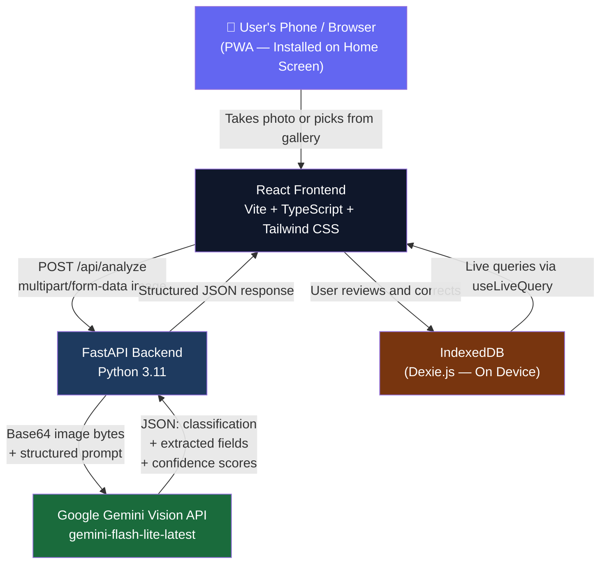
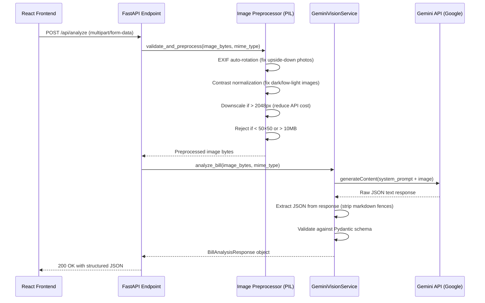

# Bill Snap — How It Works: Complete Technical Explanation

---

## 1. Big Picture Architecture



> [!IMPORTANT]
> **Key architectural principle:** Images are **never permanently stored** anywhere. The backend receives the image, sends it to Gemini, gets the result, and discards the image — all in memory. Only the extracted *text data* (merchant, date, amount) is saved — and only *on the user's device* in IndexedDB.

---

## 2. What Happens Step-by-Step (The Full Journey)

### Step 1 — User Opens the App (PWA)
The app is a **Progressive Web App**. When a user visits the URL in Chrome (mobile or desktop), the browser offers to "Add to Home Screen". Once installed, it opens **full-screen without a browser toolbar**, looking and feeling like a native app.

This is powered by:
- `vite-plugin-pwa` generating a `manifest.webmanifest` and `service worker`
- The service worker **caches** the HTML, CSS, and JS so the app loads instantly even offline
- Two icons (192px and 512px) for Android home screen and splash screens

---

### Step 2 — Taking or Uploading a Photo

When the user taps **"Take Photo"** or **"Upload from Gallery"**, a modal (`CameraUploadModal.tsx`) appears.

```
Take Photo button  → <input type="file" accept="image/*" capture="environment">
                           ↓
                   Opens rear camera on mobile
                   
Upload Gallery     → <input type="file" accept="image/*">
                           ↓
                   Opens file picker / photo library
```

**Before the image is sent**, the frontend performs 3 local validations:
1. **Format check**: Only JPG, PNG, and WEBP are allowed
2. **Size check**: Maximum 10 MB
3. **Dimension check**: Image is decoded in-browser using `new Image()` and minimum 50×50 pixels is enforced

If all pass, the image is previewed as a **Data URL** (via `FileReader.readAsDataURL`) — this ensures cross-browser compatibility since blob URLs can sometimes fail on mobile Safari.

---

### Step 3 — The 4-Stage Analysis Screen

Once the user taps **"Analyze Bill →"**, the `AnalysisLoadingView.tsx` component is shown with animated loading stages:

| Stage | What is actually happening |
| :--- | :--- |
| 🔵 Checking image | Frontend `fetch()` starts, image is being prepared |
| 🔵 Identifying bill | FastAPI receives the image; preprocessor validates it |
| 🔵 Extracting information | Gemini API call is in progress |
| 🔵 Preparing results | Gemini responded; FastAPI parses JSON and validates schema |

> There are **no fake progress percentages** — each stage reflects real work happening.

---

### Step 4 — Backend Processing (FastAPI)

The backend receives the image at `POST /api/analyze`. Here is the internal sequence:



#### Image Preprocessing (Why it matters):
The `image_preprocessor.py` module fixes real-world photo problems **before** sending to Gemini:

| Problem | Solution |
| :--- | :--- |
| Photo taken sideways/upside-down | Reads EXIF orientation tag and rotates the image to correct it |
| Very dark, underexposed photo | Increases contrast using `PIL.ImageEnhance.Contrast` |
| Very large image (slow/expensive) | Downscales longest edge to max 2048px maintaining aspect ratio |
| Corrupted file | Raises `ValueError` with error code `CORRUPTED_IMAGE` |
| Wrong format (PDF, GIF) | Raises `ValueError` with error code `UNSUPPORTED_FORMAT` |

---

### Step 5 — The Gemini Vision AI (The Brain)

This is the most critical part. The backend sends two things to Gemini:
1. The preprocessed image (as base64 bytes)
2. A carefully engineered **system prompt** (`bill_prompts.py`)

The prompt instructs Gemini to act as *"an expert financial document analyst"* and return a strict JSON structure with:

```json
{
  "classification": "BILL",
  "classification_confidence": 0.98,
  "non_bill_type": null,
  "reason": "Clear retail receipt with merchant, items, and total amount.",
  "fields": {
    "merchant_name": { "value": "Apollo Pharmacy", "confidence": 0.95, "reason": null },
    "date": { "value": "2024-10-20", "confidence": 0.92, "reason": null },
    "total_amount": { "value": 385.50, "confidence": 0.98, "reason": null },
    "currency": "INR",
    "category": { "value": "Healthcare", "confidence": 0.90, "reason": "Pharmacy medicine receipt." }
  }
}
```

**Classification logic (how it decides BILL vs NON_BILL):**
- `BILL`: Has merchant name + transaction details + an amount payable
- `NON_BILL`: Selfie, ID card, social media screenshot, landscape photo, certificate (no financial transaction evidence)
- `UNCERTAIN`: Extremely blurry, completely dark, or impossible to interpret

**Key extraction rules baked into the prompt:**
- Prefer the **final grand total** over subtotals, taxes, discounts, or line-item prices
- Never confuse an **invoice number** with an amount
- Never confuse a **phone number** or **pincode** with an amount
- Screenshots of genuine digital receipts (Amazon, Uber, Swiggy) ARE valid bills
- Format dates as `YYYY-MM-DD` always

**Model Fallback Cascade (reliability layer):**
```
Try: gemini-flash-lite-latest (fastest, cheapest)
  → If unavailable: Try gemini-3.5-flash (slower but reliable)
  → If both fail: Return 503 error with retry advice
```

---

### Step 6 — Bill or Not a Bill?

The frontend receives the JSON and routes the user to one of three screens:

```
classification == "BILL"        → ExtractionCorrectionView (review and edit screen)
classification == "NON_BILL"    → NonBillRejectionView (polite rejection with retry)
classification == "UNCERTAIN"   → NonBillRejectionView (ask user to try a clearer image)
```

---

### Step 7 — Extraction & Correction Screen (If a Bill)

The `ExtractionCorrectionView.tsx` shows the user **all 5 extracted fields** with visual confidence indicators:

| Confidence | Color | Meaning |
| :--- | :--- | :--- |
| 85–100% | 🟢 Emerald "High" badge | Clearly printed and unambiguous |
| 60–84% | 🟡 Amber "Medium" badge | Partially visible or slightly inferred |
| 0–59% | 🔴 Rose "Low" badge | Blurred, faded, or multiple conflicting values |

Low-confidence fields also show:
- A **red border** on the input box to draw attention
- An **explanation text** (e.g., *"Merchant logo is partially cropped"*, *"Multiple total amounts detected; largest selected"*)

The user can:
- Edit the **merchant name** (text input)
- Edit the **date** (date picker)
- Edit the **total amount** (number input)
- Change the **currency** (INR, USD, EUR, GBP dropdown)
- Change the **category** (dropdown with 9 options)
- Add optional **notes/tags** (e.g., "Office lunch", "Client reimbursement")

---

### Step 8 — Saving to IndexedDB (Local Storage)

When the user taps **"Save Verified Bill Locally"**, the following data structure is written to IndexedDB:

```typescript
{
  id: "bill_1699095843000_xk7p2",    // unique ID
  merchantName: "Apollo Pharmacy",    // user-corrected value
  date: "2024-10-20",                 // user-corrected value
  amount: 385.50,                     // user-corrected value
  currency: "INR",
  category: "Healthcare",
  createdAt: "2024-10-20T14:30:00Z",
  thumbnailBase64: "data:image/jpeg;base64,...",  // compressed 240px thumbnail
  userCorrected: true,                // was anything changed?
  userCorrectedFields: ["merchantName"],  // which fields were changed?
  originalExtracted: {                // AI's original values preserved
    merchantName: "Apollo Pharmacy",
    merchantConfidence: 0.95,
    merchantReason: null,
    amount: 385.50,
    amountConfidence: 0.98,
    // ... etc
  },
  notes: "Prescription refill"
}
```

> This design is important: **original AI values are stored separately from user corrections**. This creates a full audit trail — you can always see what the AI extracted vs. what the user verified.

**Why IndexedDB (Dexie.js)?**
- It is a real database built into every modern browser
- Stores megabytes of structured data (not just 5 KB like localStorage)
- Supports indexed queries (search by merchant, sort by date, filter by category)
- **No internet required** for reads and writes — 100% offline capable
- Data survives browser refresh, app close, and phone restart

---

### Step 9 — History & Insights (The List)

The `HistoryPage.tsx` uses Dexie's `useLiveQuery` hook — this means the bill list **automatically updates in real time** whenever a new bill is saved, without any manual refresh or state management.

Features:
- **Search** filters bills by merchant name as you type
- **Category filter pills** (All, Food, Groceries, Utilities, etc.)
- **Sort** by newest, oldest, highest amount, lowest amount
- **Delete** with a confirmation modal to prevent accidents
- Tapping a bill opens a **BillDetailModal** showing both original AI values and user edits side-by-side

The `InsightsPage.tsx` calculates monthly spending:
- Selects bills whose `date` starts with the current `YYYY-MM` prefix
- Groups them by category and calculates percentage of total spend
- Renders a **multi-segment color bar** and per-category bars
- **All calculations are done in-browser** using JavaScript `useMemo` — no server needed

---

## 3. ML Evaluation Pipeline

The `evaluation/` folder contains a complete offline testing framework:

```
evaluation/
├── images/
│   ├── bills/          ← 15 test images (clear, blurry, crumpled, handwritten, etc.)
│   └── non_bills/      ← 5 test images (selfie, ID card, screenshot, landscape, cert)
├── ground_truth.csv    ← Expected correct answers for all 20 images
├── run_evaluation.py   ← Script that sends all 20 images to the live API
└── results.csv         ← Generated output with AI predictions vs. ground truth
```

**How the evaluation works:**
1. Script reads `ground_truth.csv` (the "correct answers")
2. Sends each of the 20 images to `POST /api/analyze`
3. Compares AI predictions against ground truth with **smart normalization**:
   - Merchant: case-insensitive substring matching (e.g., "Starbucks" matches "STARBUCKS COFFEE")
   - Date: converts all formats to `YYYY-MM-DD` before comparing
   - Amount: allows ±0.50 tolerance for rounding differences
   - Category: case-insensitive exact match
4. Calculates and prints: **Precision, Recall, F1 score** for classification; **per-field accuracy** for extraction
5. Writes full row-by-row results to `results.csv`

**Why these 20 specific images?**

| Condition | Why included | Expected challenge |
| :--- | :--- | :--- |
| Clear printed receipt | Baseline — should be easy | None |
| Handwritten bill | Tests if AI can read cursive/varied handwriting | Merchant + amount extraction |
| Crumpled bill | Tests robustness to physical deformation | Date and amount may be partially hidden |
| Blurry bill | Tests motion blur tolerance | Character-level ambiguity (3 vs 8) |
| Angled photograph | Tests perspective distortion handling | Layout may appear skewed |
| Low-light photograph | Tests dark image recovery | Faint ink contrast |
| Faded thermal receipt | Tests degraded print quality | Total amount may be unreadable |
| Selfie | Tests false positive prevention | Should always be NON_BILL |
| ID card | Tests personal document rejection | Should always be NON_BILL |
| Screenshot | Tests that digital receipts are accepted | Should be BILL if it's a real receipt |

---

## 4. Security & Privacy Design

| Concern | How it is handled |
| :--- | :--- |
| API key exposure | `GEMINI_API_KEY` lives only in `backend/.env`; never sent to or exposed in the frontend |
| Image privacy | Backend never writes images to disk; processed entirely in RAM and discarded after response |
| User data | Bills saved only in the user's own browser IndexedDB; never uploaded to any external database |
| CORS | Backend explicitly allows only the frontend origin (or `*.onrender.com` on production) |
| File validation | Both frontend (format, size, dimensions) and backend (PIL validation) independently validate images |

---

## 5. What Would You Say in the Interview?

**"Why PWA and not React Native?"**
> PWA is faster to build, deploy, and test. No App Store submission needed. It runs on both Android and iOS from a single codebase. For a demo/internship task, the camera API (`capture="environment"`) covers the mobile camera requirement without native code.

**"Why Gemini Vision instead of on-device OCR?"**
> On-device OCR (Tesseract) can read text but cannot *understand context* — it cannot decide if an image is a bill, infer the correct "total" from multiple amounts, or suggest a spending category. Gemini Vision is a multimodal model that sees the whole document as a human would. The tradeoff is a network request, but the result quality is dramatically better.

**"Where does it fail?"**
> Honestly: (1) When merchant names are not printed (e.g., handwritten Kirana shops without headers), the AI returns `null` with low confidence — which is correct behavior. (2) Very faded thermal receipts where the total amount is unreadable. (3) Bills in non-Latin scripts (Tamil, Hindi) may have lower extraction accuracy. These are displayed with red-bordered fields asking the user to correct them manually.

**"How do you know it works? Can you show numbers?"**
> Yes — the `evaluation/` folder contains 20 benchmark images with ground truth. Running `python evaluation/run_evaluation.py` against the live API produces a results table with field-level accuracy, precision, and recall. This is exactly what the internship task asked for.
