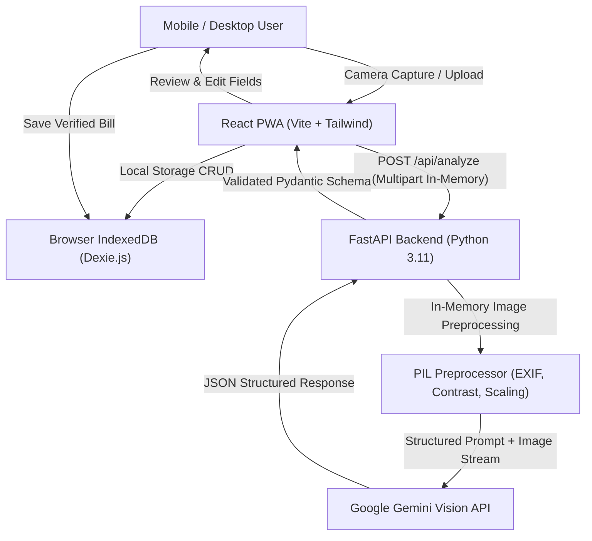

# Bill Snap — Smart Mobile-First Bill Scanner & Organizer

> **"Your bills, organized in seconds."**

Bill Snap is a mobile-first Progressive Web Application (PWA) that allows users to photograph or upload receipts and bills, automatically classify whether an image is a genuine financial document, extract crucial transaction fields (merchant, date, total amount, category), audit AI confidence scores, correct uncertain information, and securely save records locally in IndexedDB.

---

## 1. Project Overview & Main User Journey

1. **Capture / Select**: Take a photo using a mobile camera (`capture="environment"`) or select a receipt screenshot/image from the gallery.
2. **Preprocessing**: In-memory orientation correction (EXIF transposition), contrast normalization, and resolution checks via Pillow.
3. **AI Multimodal Classification**: Google Gemini Vision verifies whether the document represents a genuine commercial transaction (`BILL` vs `NON_BILL` vs `UNCERTAIN`).
4. **Information Extraction**: Automatically extracts merchant name, date, grand total, currency, and predicts spending category with field-level confidence ratings and explanations.
5. **Non-Bill Guardrail**: Non-financial images (selfies, ID cards, landscape photos, certificates) are politely rejected with actionable explanations.
6. **Review & Correction**: Users review high/medium/low confidence badges, inspect reasons for any ambiguity, and correct any field before saving.
7. **Local Persistence**: Records persist locally in IndexedDB (Dexie.js) with thumbnails. No permanent server storage; 100% private.
8. **History & Spending Insights**: Search, filter, and sort saved bills; explore dynamic monthly category spend breakdowns and average expenditure metrics.

---

## 2. Key Features

- **Mobile Camera & PWA**: Touch-optimized UI, responsive card design, offline app shell caching, and home-screen installability.
- **Multimodal AI Vision**: Powered by Gemini Vision (`gemini-2.5-flash`), eliminating brittle regex-based OCR cascades.
- **Transparent Confidence & Uncertainty**: Field-level confidence scores (High $\ge 85\%$, Medium $60-84\%$, Low $<60\%$) with explanatory rationale.
- **Zero Permanent Server Storage**: Uploaded images are validated and analyzed strictly in-memory (`io.BytesIO`) and discarded immediately.
- **Local-First Privacy**: Financial records and thumbnails live only in the user's browser IndexedDB.
- **ML Evaluation Harness**: 20-image benchmark dataset (15 bill conditions, 5 non-bill documents) with automated precision/recall evaluation script and ground truth CSV.

---

## 3. Technology Stack

### Frontend
- **Framework**: React 18+ with TypeScript
- **Build Tool**: Vite 5
- **Styling**: Tailwind CSS
- **Icons**: Lucide React
- **Client Database**: Dexie.js (IndexedDB wrapper) & `dexie-react-hooks`
- **Routing**: React Router DOM v6
- **PWA**: `vite-plugin-pwa` with service worker precaching

### Backend
- **Language**: Python 3.11+
- **Framework**: FastAPI (high-performance asynchronous ASGI)
- **Validation**: Pydantic v2 schemas
- **Vision Preprocessing**: Pillow (PIL)
- **AI/ML Engine**: Google Gen AI SDK (`google-genai` / `google.genai`)
- **Server**: Uvicorn
- **Testing**: Pytest & FastApi TestClient

---

## 4. System Architecture



---

## 5. Quick Start (Windows PowerShell)

### Prerequisites
- Node.js v18+ (tested on v24.20.0)
- Python 3.11+
- Google Gemini API Key (free from [Google AI Studio](https://aistudio.google.com/app/apikey))

---

### Step 1: Backend Setup

Open a PowerShell terminal:

```powershell
# Navigate to the backend directory
cd "backend"

# (Optional) Create and activate a virtual environment
python -m venv venv
.\venv\Scripts\Activate.ps1

# Install backend dependencies
python -m pip install -r requirements.txt

# Create your .env file from template
Copy-Item .env.example .env
```

Edit `backend/.env` to insert your Gemini API Key:
```env
GEMINI_API_KEY=your_actual_gemini_api_key_here
GEMINI_MODEL=gemini-2.5-flash
PORT=8000
HOST=0.0.0.0
```

Start the FastAPI backend server:
```powershell
python -m uvicorn app.main:app --reload --port 8000
```
Backend will be live at: `http://127.0.0.1:8000` (Interactive Swagger Docs at `http://127.0.0.1:8000/docs`).

---

### Step 2: Frontend Setup

Open a second PowerShell terminal:

```powershell
# Navigate to frontend directory
cd "frontend"

# Install npm dependencies
npm install

# Start the Vite development server
npm run dev
```
Frontend will be live at: `http://localhost:5173`.

---

## 6. Running Automated Tests

Run the complete 15-test automated backend test suite (uses mocked Gemini responses, requiring no paid API calls or keys):

```powershell
cd "backend"
python -m pytest tests/test_api.py -v
```

**Test Coverage Highlights:**
- Root & health check endpoints.
- In-memory image preprocessing (EXIF rotation, downscaling large images, minimum dimension checks).
- File metadata validation (rejecting non-image MIME types, corrupted bytes, oversized files).
- Valid bill response parsing and Pydantic schema validation.
- Non-bill detection (selfies, ID cards) returning clean rejections without errors.
- Torn/faded receipts handling missing fields as `null` with uncertainty reasons.
- Transient API failure error propagation and JSON fence stripping.

---

## 7. Running the 20-Image ML Evaluation Pipeline

Bill Snap includes a mandatory 20-image benchmark dataset (15 genuine bill conditions + 5 non-bill documents):

```powershell
# Ensure the backend server is running in another terminal
python evaluation/run_evaluation.py
```

The script will:
1. Ping `/api/health` to confirm server readiness.
2. Read the 20 benchmark test images from `evaluation/images/`.
3. Dispatch each image to `/api/analyze`.
4. Compare model predictions against `evaluation/ground_truth.csv` using normalized matching (date parsing, merchant case-folding, amount numerical tolerance $\pm 0.50$).
5. Output `evaluation/results.csv`.
6. Print the terminal summary report with precision, recall, and field-level accuracy.

---

## 8. Security & Privacy Architecture

- **No Permanent Server Storage**: Images are processed strictly in-memory (`io.BytesIO`) and discarded immediately upon response.
- **Client-Side Data Ownership**: All saved bills, notes, and thumbnails reside exclusively in the client's browser IndexedDB.
- **Credential Protection**: The Google Gemini API key is managed securely on the backend server; it is never exposed to the frontend or git repository.
- **Payload & File Guards**: File size limit capped at 10 MB; MIME type and binary header integrity validated via Pillow before LLM invocation.
- **Sanitized Logging**: Server logs record classification summaries and status codes without dumping sensitive receipt contents or customer data.

---

## 9. Known Limitations

1. **Internet Dependency for AI**: Multimodal visual inference requires active connectivity to Google Gemini Vision. The application shell, local history, and spending insights function offline.
2. **Extreme Print Degradation**: Receipts with $>70\%$ thermal ink fading or severe motion blur may produce low confidence scores or missing total amounts.
3. **Model Heuristic Confidence**: AI confidence scores represent model heuristic self-assessments, not Bayesian-calibrated statistical probabilities.

